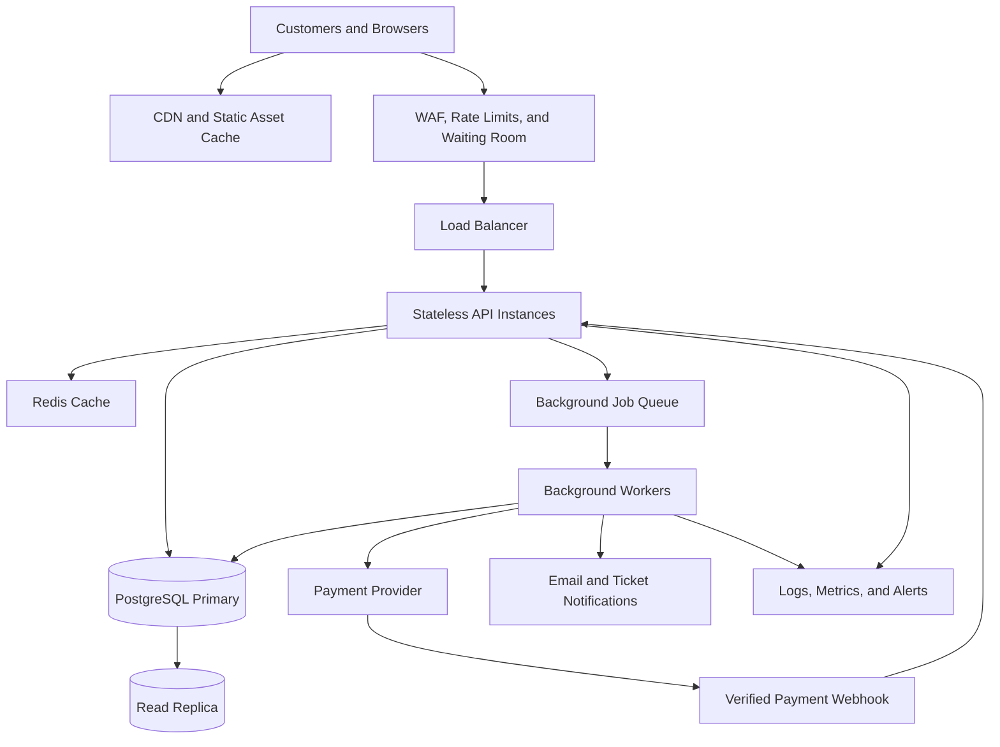

# TicketHub: System Design

## 1. Requirements

### Functional requirements

1. Users can register, sign in, and manage their accounts.
2. Users can browse, search, and filter concerts and events by name, date, venue, and category.
3. Users can view an event's seating plan and current seat availability.
4. Users can temporarily hold available seats while completing checkout.
5. Users can pay for a valid seat hold and receive a confirmed order and ticket.
6. Users can view their orders and tickets.
7. The system releases expired or abandoned holds so seats become available again.
8. Administrators can create events, configure seats and prices, and monitor sales.

### Non-functional requirements

- **Speed:** Event pages and seat availability should usually load within 2 seconds under normal traffic. Checkout requests should return promptly, with payment processing handled asynchronously where appropriate.
- **Correctness:** A seat must not be confirmed for more than one order. Order and payment states must remain consistent, even if a client retries a request or a service fails.
- **Fairness:** Use a clear, consistently applied first-come-first-served policy for successful seat holds. Apply rate limits and queue or throttle bursts rather than allowing one user to flood the service. The system must not promise every visitor a ticket when demand exceeds supply.
- **Availability and resilience:** Browsing should remain available during a sale even if checkout is under heavy load. Services should recover from instance failures, and payment callbacks must be safe to retry.
- **Security:** Require authentication for holds, purchases, and ticket access. Validate inputs, use HTTPS, protect payment data by using a payment provider, and allow users to see only their own orders.
- **Scalability:** Add application instances and caching to handle sudden traffic spikes.
- **Monitoring:** Record metrics and logs for request latency, hold failures, payment errors, queue depth, and remaining inventory.

## 2. Traffic and capacity estimates

These estimates are planning assumptions, not measured production results. A page view is counted as one request to the web application; static assets and API calls can generate additional requests.

### Normal-day traffic

- Registered users: **2,000,000**
- Daily visitors: **50,000**
- Page views per visitor: **10**
- Page views per day: 50,000 × 10 = **500,000**
- Average page views per second: 500,000 ÷ 86,400 ≈ **5.8 requests/second**
- Tickets sold per day: **5,000**
- Average sales rate across 24 hours: 5,000 ÷ 86,400 ≈ **0.058 tickets/second**, or about 208 tickets per hour on average.

Traffic is not evenly distributed throughout the day. As an initial planning assumption, allow a 10× normal peak: approximately **58 page requests per second**. Load testing should be used to validate this estimate.

### Popular concert sale

- People trying to buy tickets: **200,000 within 10 minutes**
- Average arrival rate: 200,000 ÷ 600 ≈ **333 people per second**
- Seats available: **20,000**
- Maximum seat-to-visitor ratio: 20,000 ÷ 200,000 = **10%**. At most one in ten visitors can obtain a seat if each person buys one.
- The 200,000 visitors represent **4× the normal day's 50,000 visitors arriving in just ten minutes**.
- If each visitor makes 10 page/API requests during this window, the system receives 2,000,000 requests ÷ 600 ≈ **3,333 requests per second**. Actual request rates could be higher because of refreshes, retries, polling, and multiple API calls per page.

The estimated big-sale rate is approximately **57× the estimated normal peak** of 58 requests per second, and about **575× the normal daily average** of 5.8 requests per second.

These figures are approximate and should be validated with realistic load tests. The main challenge is not only serving pages but coordinating access to a limited inventory of 20,000 seats.

## 3. API design

TicketHub uses a versioned REST API under `/api/v1`. Requests and responses use JSON. Authentication is required for seat holds, purchases, and personal tickets.

| Method and endpoint | Purpose | Important behavior |
|---|---|---|
| `GET /api/v1/events` | Browse and search events | Supports filters such as `q`, `date`, `category`, `page`, and `limit`. Results can be cached. |
| `GET /api/v1/events/{eventId}` | View event details | Returns venue, date, event information, and seating configuration. |
| `GET /api/v1/events/{eventId}/seats` | View seat availability | Returns seat IDs, sections, prices, and states such as available, held, or sold. Availability is a snapshot, not a guarantee. |
| `POST /api/v1/holds` | Temporarily hold seats | Accepts `eventId`, `seatIds`, and an idempotency key. Succeeds only if all requested seats are available; otherwise returns `409 Conflict`. |
| `DELETE /api/v1/holds/{holdId}` | Release a hold | Releases seats if the hold is still active and belongs to the authenticated user. |
| `POST /api/v1/orders` | Create an order and initiate checkout | Validates hold ownership and expiry, uses an idempotency key, and creates a pending order. |
| `POST /api/v1/payments/webhook` | Receive payment updates | Verifies the payment provider's signature and processes duplicate callbacks safely. |
| `GET /api/v1/me/orders` | View personal orders | Returns only orders belonging to the signed-in user. |
| `GET /api/v1/me/tickets` | View confirmed tickets | Returns tickets associated with paid and confirmed orders. |

Typical HTTP errors include:

- `400 Bad Request` — invalid input.
- `401 Unauthorized` — authentication is missing.
- `403 Forbidden` — the user is not allowed to access the resource.
- `404 Not Found` — the requested resource does not exist.
- `409 Conflict` — a seat is unavailable or a hold has expired.
- `429 Too Many Requests` — a rate limit has been reached.

Idempotency keys are used for operations that may be retried so a network retry does not create duplicate orders or charges.

## 4. Data model

Use a relational database such as PostgreSQL because transactions, unique constraints, and row-level locking are important for ticket inventory.

### Table 1: `users`

- `id` — primary key.
- `name` — user's name.
- `email` — unique email address.
- `password_hash` — securely hashed password.
- `created_at` — account creation time.

### Table 2: `events`

- `id` — primary key.
- `name` — event name.
- `venue` — event venue.
- `starts_at` — event date and time.
- `sale_starts_at` — ticket sale start time.
- `status` — draft, on_sale, sold_out, or cancelled.
- `created_at` — record creation time.

### Table 3: `seats`

- `id` — primary key.
- `event_id` — foreign key referencing `events.id`.
- `section` — seating section.
- `row_label` — row identifier.
- `seat_number` — seat number.
- `price` — ticket price.
- `status` — available, held, or sold.
- `hold_expires_at` — expiry time for a temporary hold; nullable.
- `hold_user_id` — nullable foreign key referencing `users.id`.
- `version` — optional integer for optimistic concurrency control.

Add a unique constraint on `(event_id, section, row_label, seat_number)` so a physical seat is defined only once for an event.

### Table 4: `orders`

- `id` — primary key.
- `user_id` — foreign key referencing `users.id`.
- `status` — pending_payment, paid, failed, cancelled, or refunded.
- `total_amount` — total order price.
- `currency` — currency code.
- `idempotency_key` — identifier used to prevent duplicate order requests.
- `created_at` — order creation time.
- `paid_at` — payment confirmation time; nullable.

Add a unique constraint on `(user_id, idempotency_key)` to prevent a retried order request from creating duplicate orders for the same user.

### Table 5: `order_items`

- `id` — primary key.
- `order_id` — foreign key referencing `orders.id`.
- `seat_id` — foreign key referencing `seats.id`.
- `unit_price` — price of the seat at purchase time.
- `ticket_code` — unique ticket identifier, nullable until confirmed.

Add a unique constraint on `order_items.seat_id` for the single-event, single-sale model. This prevents the same seat from being attached to multiple order items.

If an order is cancelled or refunded, keep its item as an audit record. The seat should only be made available again through an explicit, safely implemented release or resale workflow.

### Relationships

- One user can have many orders.
- One event can have many seats.
- One order can have many order items.
- Each order item refers to one seat.
- A seat belongs to one event and can be temporarily held by a user.

The seat status is useful for availability checks, but it is not enough on its own to guarantee correctness. Transactional updates and database constraints enforce the ownership rules.

## 5. Preventing two people from buying the same seat

The seat list displayed in a browser can become outdated immediately. Two users might both see a seat as available and attempt to purchase it at the same time. Therefore, the frontend must not be responsible for deciding who owns a seat.

TicketHub uses **temporary seat holds, atomic database transactions, and database constraints**.

### Step 1: Request a hold

When a user selects a seat, the client sends `POST /api/v1/holds` with the seat ID and an idempotency key.

### Step 2: Start a transaction and lock the seat

The backend starts a database transaction and locks the requested seat row or rows using `SELECT ... FOR UPDATE`, or an equivalent atomic conditional update.

Inside the transaction, it checks whether the seat is available or its previous hold has expired.

### Step 3: Reserve the seat temporarily

If the seat is available, the backend changes its status to `held`, records the user's ID, and sets `hold_expires_at`, for example, five minutes in the future.

The transaction commits. If another user requests the same seat, their request must wait for the lock and then re-check the seat's status. They receive `409 Conflict` instead of obtaining a second hold.

### Step 4: Complete payment

The user completes payment before the hold expires. The backend verifies that the hold belongs to the user and is still valid.

It creates a pending order and contacts the payment provider outside the database transaction. It must not keep a database transaction open while waiting for a remote payment service.

### Step 5: Confirm the purchase

After payment is confirmed through a verified callback or status check, the backend transactionally updates the order to `paid`, marks the seat `sold`, and creates the confirmed ticket.

The unique constraint on `order_items.seat_id` provides an additional safeguard against assigning the same seat to multiple orders.

### Step 6: Release expired holds

A background job periodically finds holds whose expiry times have passed and releases them. It uses a conditional update to ensure it only releases a seat that is still held and whose hold has actually expired. This prevents cleanup from accidentally releasing a newer hold.

### What if payment succeeds after the hold expires?

The system must not sell an already-held seat twice. It should use a defined recovery process, such as safely reallocating an available seat or refunding the late payment.

### Why this works

The database transaction makes checking and changing the seat's state an atomic operation. Row locks coordinate competing requests, and unique constraints provide a final safeguard. Idempotency prevents repeated requests and payment callbacks from creating duplicate orders.

A frontend display or distributed cache alone cannot guarantee that two people will not buy the same seat.

## 6. Architecture and handling the big sale

### Architecture diagram

### Component explanations

**1. CDN and static asset cache**

Serves JavaScript, CSS, images, and other static files close to users. This reduces response time and the load on the API servers.

**2. Web application firewall, rate limits, and waiting room**

Filters abusive traffic, limits repeated requests, and admits users at a controlled rate. The waiting room should apply a transparent and consistent queue policy. A queue position does not guarantee a ticket.

**3. Load balancer and stateless API instances**

The load balancer distributes requests across multiple API instances. The instances are stateless, meaning they do not depend on session information stored only in their own local memory. This allows the application to scale horizontally and recover from instance failures.

**4. Redis cache**

Stores frequently requested read data, such as event details. It reduces database load but is not the source of truth for seat ownership.

**5. PostgreSQL primary database**

Stores authoritative seat, hold, and order information. Transactions, row locks, and constraints protect against double-booking. Seat-changing operations must use the authoritative database.

**6. Queue and background workers**

Handle notifications, hold-expiry cleanup, and other retryable tasks outside the main request path. Workers must process jobs idempotently so retries do not cause duplicate effects.

**7. Payment provider and verified webhook**

The payment provider processes payments and reports outcomes. TicketHub verifies webhook signatures and safely handles duplicate events.

**8. Read replica**

Can handle suitable browsing queries to reduce load on the primary database, provided replication lag is acceptable. It must not make the final decision about whether a seat can be sold.

**9. Logs, metrics, and alerts**

Monitor request latency, errors, queue depth, database lock waits, hold success rates, payment failures, and inventory discrepancies.

### Big-sale operating plan

1. Cache event details and static assets before the sale begins.
2. Use a waiting room and admission control to smooth the incoming burst.
3. Scale stateless API instances horizontally while protecting the database from unlimited concurrent seat-write traffic.
4. Keep inventory-changing operations short and transactional.
5. Queue notifications and other non-critical tasks instead of making users wait for them.
6. Reduce unnecessary polling and use controlled refresh intervals or server-sent updates if real-time availability updates are needed.
7. Monitor database contention, payment errors, and queue depth throughout the sale.
8. Load-test the expected traffic and failure scenarios before production.

The key is to scale browsing separately from seat allocation. Many users can read event information simultaneously, but every seat purchase must pass through the authoritative inventory checks.

## 7. Trade-offs

### Trade-off 1: Strong consistency vs. maximum throughput

Database transactions, row locks, and uniqueness constraints make seat ownership reliable. However, competing requests for the same seat may have to wait, reducing write throughput.

This is an intentional choice because selling the same seat twice is worse than delaying or rejecting a request. TicketHub can improve read performance through caching and replicas while keeping seat allocation on the primary database.

### Trade-off 2: Fairness vs. speed of access

A virtual waiting room and rate limits make access more orderly and reduce overload. However, users may have to wait even when the website appears responsive.

A queue also cannot guarantee a ticket because 200,000 people are competing for only 20,000 seats. The queue policy should be transparent and consistently enforced.

### Trade-off 3: Cache freshness vs. database load

Caching event details and availability snapshots improves speed and reduces database load. However, cached seat availability can become stale.

The website might display a seat as available after another user has already held it. The hold endpoint must therefore re-check and atomically update the database before accepting a reservation.

### Trade-off 4: Short holds vs. checkout completion

Short holds return abandoned seats to the sale quickly, but users with slow connections or payment delays may lose their seats. Longer holds provide more time to complete checkout but can leave abandoned seats unavailable for longer.

A five-minute hold is a starting assumption that should be tested against real checkout data. The system also needs clear expiry messages and safe handling of late payment outcomes.

## Conclusion

TicketHub should optimize ordinary browsing through caching and horizontal scaling, while protecting purchases through an authoritative inventory database, atomic seat holds, database constraints, idempotent payment processing, and controlled admission during major sales.

The traffic calculations are starting estimates rather than guarantees. Realistic load testing is needed to validate the system before production.
